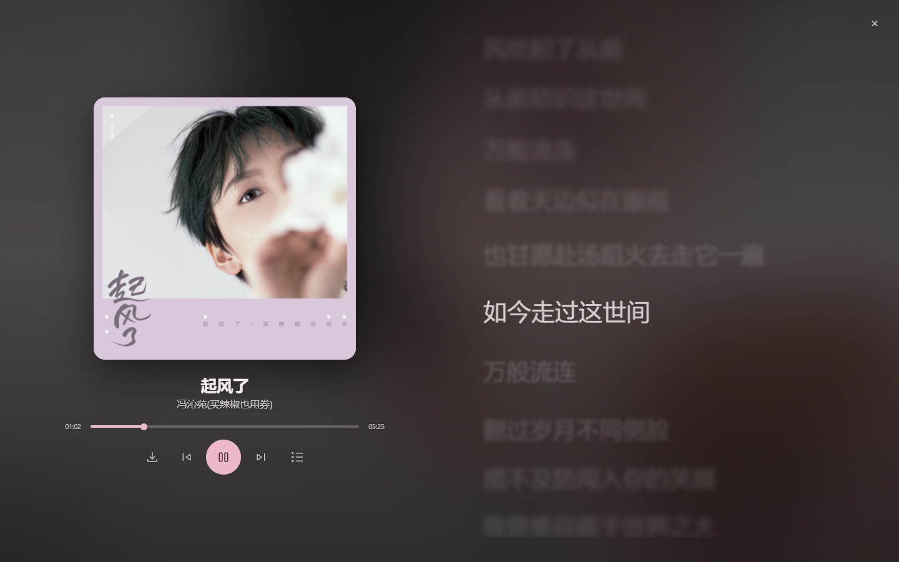

# 私享音乐盒 · PMusic Box

一个自托管的网易云音乐网页播放器：搜歌、播放、封面取色、大屏歌词、歌单管理。
前端是纯静态页面（零构建），接口由一个 Cloudflare Worker 代理，没有自己的服务器。

> 仅供个人学习与自用。不提供、不存储任何音乐内容，所有音频/歌词均实时来自网易云公开接口。



## 功能

- **搜索 / 播放 / 下载**：网易云搜索、播放直链、单曲下载 MP3
- **主题**：Material 3 风格，颜色从专辑封面动态取色（OKLCH 生成色调板），也可指定种子色；深色模式不用纯黑
- **大屏模式**：封面 + 歌词；当前行高亮、其余行模糊；点歌词跳转
- **歌词**：逐字歌词（yrc）、翻译、歌词偏移、字号、加粗；渲染器为 [AMLL](https://github.com/amll-dev/applemusic-like-lyrics)
- **歌单**：导入网易云歌单、本地自建歌单、编辑名称与封面（封面裁成 320×320 存 `localStorage`）
- **播放队列**：锚定在按钮上方的弹出菜单，按住把手拖动即可自由排序
- **PC / 移动分流**：按 UA / Client Hints 在边缘返回不同 HTML，手机端单独一套布局
- **访问控制**：可选的账号登录（多账号，各自绑定自己的网易云 `MUSIC_U`）、可选的访问口令

## 架构

```
浏览器 ──► Cloudflare Pages（静态站点 + Functions 中间件）
             │  按设备分流：/ → /index.html（桌面） 或 /m/（移动）
             │
             └─► Cloudflare Worker（/api/*）──► 网易云 weapi（AES + RSA 加密）
```

- `site/`：纯静态前端，**没有构建步骤**，改完直接部署
- `functions/_middleware.js`：Pages Functions，按 UA 把 `/` 重写到桌面版或 `/m/`
- `worker/`：桌面/移动共用的 API 代理，负责加密、Cookie、登录与账号校验
- `site/js/music-page.js`：全部前端逻辑（约 3000 行，无框架）

## 目录

```
site/                  Pages 发布目录
  index.html           桌面版
  m/index.html         移动版（由 scripts/gen-mobile.mjs 生成，别直接改）
  css/music-page.css   全部样式
  js/music-page.js     全部逻辑
  js/qrcode.js         二维码（扫码登录，MIT）
  vendor/              AMLL 歌词组件的打包产物（AGPL-3.0）
  _headers             Pages 响应头
functions/
  _middleware.js       PC / 移动分流
worker/
  src/index.js         API 代理（搜索/歌词/直链/歌单/登录/二维码）
  dev-server.mjs       本地把 Worker 跑在 Node 上
  test.mjs             冒烟测试（不需要 Cloudflare 账号）
  wrangler.toml
scripts/
  gen-mobile.mjs       由 index.html 生成 m/index.html
  build-amll.mjs       重新打包 AMLL（平时不用跑）
docs/SELF-HOSTING.md   部署与配置详解
```

## 快速开始

完整的部署步骤见 [docs/SELF-HOSTING.md](docs/SELF-HOSTING.md)，这里是最短路径。

### 1. 本地跑起来

```bash
# 终端 A：启动 Worker（默认 8787）
node worker/dev-server.mjs

# 终端 B：启动静态站点（别用 file://，跨域会拿不到接口）
npx serve site -l 8080
```

浏览器打开 <http://localhost:8080>，页面默认请求 `https://YOUR-WORKER.workers.dev`（已改为占位符
`https://YOUR-WORKER.workers.dev`），本地调试时把它改成 `http://127.0.0.1:8787`：

```html
<!-- site/index.html 末尾 -->
<script>window.MUSIC_API = 'http://127.0.0.1:8787';</script>
```

### 2. 部署 Worker

```bash
cd worker
npm i -g wrangler            # 或用 npx wrangler
wrangler login
wrangler deploy
```

按需添加 Secret（都不是必需的，但不加就只能听匿名可听的歌）：

```bash
wrangler secret put MUSIC_U      # 你的网易云 MUSIC_U cookie，填了才能取 VIP 曲目直链
wrangler secret put API_TOKEN    # 可选：填了之后所有接口都要带 ?k=<token>
wrangler secret put ACCOUNTS_JSON # 可选：多账号表，见下方“账号”
wrangler secret put SESSION_SECRET # 可选：登录态签名密钥，30 天有效
```

### 3. 部署前端到 Pages

```bash
# 仓库根目录
wrangler pages deploy site --project-name pmusic-box
```

或者把仓库连到 Cloudflare Pages：构建命令留空，输出目录填 `site`。
`functions/` 会被 Pages 自动识别，`wrangler.toml` 里的 `pages_build_output_dir = "site"` 也指向它。

部署后把 `site/index.html` 里的 `window.MUSIC_API` 改成你的 Worker 域名，再重新生成移动版：

```bash
node scripts/gen-mobile.mjs
```

## 账号（可选）

不配账号也能用（默认 `REQUIRE_LOGIN = false`）。要开登录，按优先级支持三种来源：

1. **KV 绑定 `ACCOUNTS`**：key = 账号名，value = `{"password":"明文"}` 或 `{"passwordHash":"<sha256 hex>"}`，
   还可加 `"musicU":"..."` 让该账号用自己的网易云 Cookie
2. **Secret `ACCOUNTS_JSON`**：`[{"name":"alice","password":"***","musicU":"***"}]`
3. **代码里的 `BUILTIN_ACCOUNTS`**：公开版本默认为空数组，别把密码写进仓库

`SESSION_SECRET` 不填时会退化为用账号表本身做签名密钥；正式部署建议单独设一个。

## 环境变量一览（Worker）

| 名称 | 类型 | 作用 |
|---|---|---|
| `MUSIC_U` | Secret | 网易云登录 cookie，填了才能取 VIP 曲目直链 |
| `API_TOKEN` | Secret | 填了之后所有接口需带 `?k=<token>` |
| `ACCOUNTS_JSON` | Secret | 多账号表（JSON 数组） |
| `SESSION_SECRET` | Secret | 登录态 HMAC 密钥 |
| `REQUIRE_LOGIN` | Var / Secret | `true` 时未登录不能访问 |
| `REQUIRE_PASS` | Var / Secret | `true` 时先过口令；`PASSWORD` 为空则等于不设防 |
| `PASSWORD` | Var / Secret | 访问口令 |
| `ALLOWED_ORIGIN` | Var | 允许的跨域来源，逗号分隔 |

前端本地开发时，`worker/dev-server.mjs` 会把上述变量透传给 Worker。

## PC / 移动分流

`functions/_middleware.js` 用 `Sec-CH-UA-Mobile` 优先、UA 兜底判断设备：

- 手机 → `/m/index.html`（`data-device="m"`）
- 桌面 / 平板 → `/index.html`

HTML 一律 `Cache-Control: private, no-store` + `Vary`，避免 CDN 把桌面版缓存后发给手机。
`site/m/index.html` 是生成的，改完桌面版后执行：

```bash
node scripts/gen-mobile.mjs
```

## 歌词：AMLL

逐字歌词由 [AMLL](https://github.com/amll-dev/applemusic-like-lyrics) 渲染，打包产物在 `site/vendor/`：

- `amll-core.js`：约 392 KB（brotli 约 100 KB），只在打开大屏时按需加载
- `amll-core.css`：约 6.7 KB

重新打包（升级 AMLL 时）：

```bash
npm i -D esbuild @applemusic-like-lyrics/core @pixi/app @pixi/core @pixi/display \
  @pixi/filter-blur @pixi/filter-bulge-pinch @pixi/filter-color-matrix @pixi/sprite
node scripts/build-amll.mjs
```

也可以把这两个文件放到自己的 CDN 上（`site/js/music-page.js` 顶部）：

```js
var AMLL_CDN = 'https://cdn.example.com/amll/20261204/';  // 结尾斜杠；留空=只用本地
var AMLL_LOCAL = '/vendor/';                               // 兜底
```

CDN 拉取失败会自动回退到本地。缓存建议 `Cache-Control: public, max-age=31536000, immutable`，
目录按版本号分（升级换目录，别覆盖旧文件），并开启 gzip/brotli。

> ⚠️ **AMLL 是 AGPL-3.0-only**。把它打包进本项目后，整个项目按 **AGPL-3.0** 发布：
> 只要站点公开可访问，就必须向访问者提供完整源码。不想受此约束的话，需要移除
> `site/vendor/` 与 `site/js/music-page.js` 中的 AMLL 相关代码，退回自带的轻量歌词渲染器。

## 已知限制

- 网易云接口非官方、随时可能变；VIP / 版权受限曲目需要有效的 `MUSIC_U`
- 登录态存在浏览器的 `localStorage`，换设备需重新登录
- 歌单、封面、设置全部存在浏览器本地，没有服务端数据库
- 请勿公开大规模分发，容易导致 Worker 出口 IP 被限流

## 许可证

[AGPL-3.0-only](LICENSE)。第三方组件见 [THIRD-PARTY-NOTICES.md](THIRD-PARTY-NOTICES.md)。

## 免责声明

本项目仅用于学习 Web 技术与自用，不提供任何音乐内容，不绕过任何付费机制。
所有音乐、歌词、封面版权归网易云音乐及相应版权方所有。
